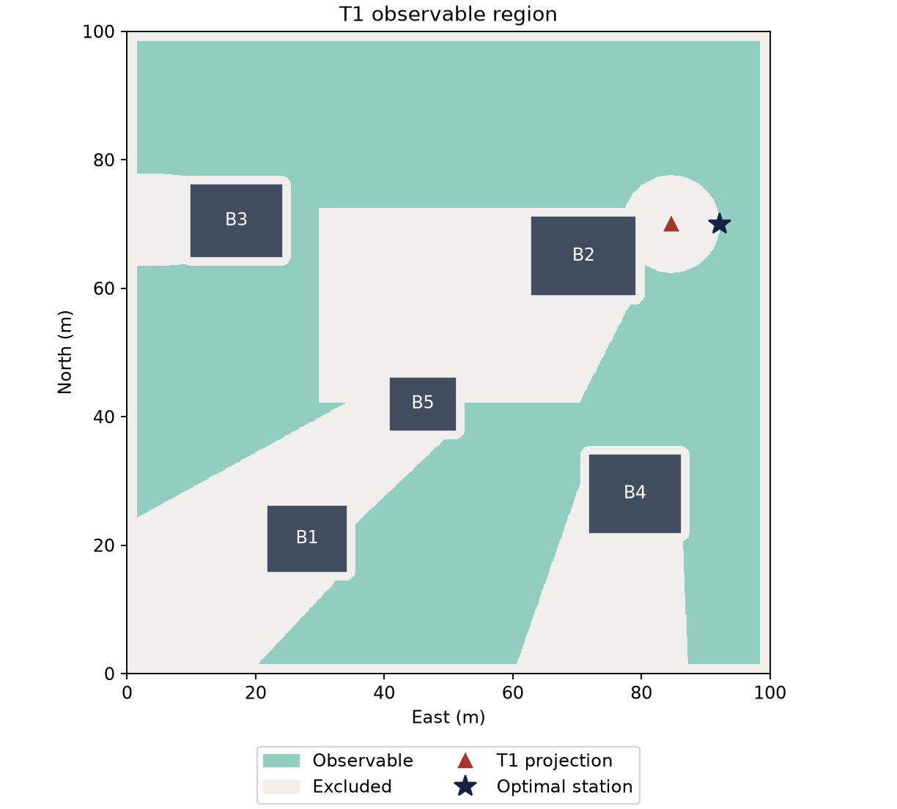

# 数维杯 B 题解题总稿（修订稿）

本稿是三名队员共同使用的解题版本。第 1 问建立单站可观测域；第 2 问先评估双站定位精度，再为三条同时出现的告警排程；第 3 问单独研究随机误差；第 4 问从第 2 问（2）的同一份原计划出发，比较扰动后的两种决策。原题依据见[英文 B 题](../2026_%E2%80%9CShuWei%20Cup%E2%80%9DB_Problem.pdf)。

**本次修订结果。** 第 1 问给出可观测域图与可达到的最优距离。第 3 问在加性云台误差解释下求得 95% 达标边界约为 66.83726 m。第 2 问（1）已由 A 给出达到下界的可行站对，证明、两辆车的路线和用时见[最终实现路线 §5.2](../赛前准备/实现路线/B题最终实现路线.md)。第 2 问（2）和第 4 问仍待五车事件表和逐场景成绩。文末列出[修改意见](../修改意见/B题解题总稿_修改意见.md)的处理结果。

## 共用场景与计算口径

场地为 $[0,100]\times[0,100]$，西南角为原点，东为 $x$ 正向，北为 $y$ 正向。调度中心 $O=(50,50)$。告警方位角从正东逆时针量取。按 $T'=(50+R\cos\theta,50+R\sin\theta)$ 得到目标水平投影。部署期间目标静止，高度由告警给定。

| 目标 | 告警 $(\theta,R,H)$ | 水平投影 $T'$，单位 m |
|---|---|---|
| T1 | $(30^\circ,40,45)$ | $(84.6410,70.0000)$ |
| T2 | $(150^\circ,45,35)$ | $(11.0289,72.5000)$ |
| T3 | $(285^\circ,38,55)$ | $(59.8351,13.2948)$ |

五辆车 V1 至 V5 的起点依次为 $(15,14)$、$(88,10)$、$(14,86)$、$(88,68)$、$(50,93)$。车体半径 1.5 m，车速 3 m/s，相机位于车体中心上方 2 m。表中显示值作核对，程序从原始告警计算全精度坐标。

| 建筑 | $x$ 范围（m） | $y$ 范围（m） | 高度（m） |
|---|---|---|---:|
| B1 | [22,34] | [16,26] | 20 |
| B2 | [63,79] | [59,71] | 28 |
| B3 | [10,24] | [65,76] | 12 |
| B4 | [72,86] | [22,34] | 24 |
| B5 | [41,51] | [38,46] | 32 |

几何和时间线共用以下三项判定（原题第 2–3 页）。

1. **整车能否停、能否走。** 车心须在 $[1.5,98.5]^2$ 内，到每个建筑占地矩形的最短平面距离须至少为 1.5 m。本稿按题面“不得进入建筑内部”允许车体从外侧恰好相切。建筑角部按圆角处理。对整条行驶路线也检查这一条件，包括两路点之间的每一段。直线可通行时取直线，否则取实际求得的可通行绕行路线，记长度为 $L$，行驶用时 $L/3$。
2. **相机能否看见。** 站点 $S$ 与目标投影相距 $r$ 时，仰角为 $\phi=\operatorname{atan2}(H-2,r)$，须落在 $[-10^\circ,80^\circ]$。检查从 $(S_x,S_y,2)$ 到 $(T_x,T_y,H)$ 的三维线段是否碰到任一**原建筑**长方体。视线碰到面、棱或顶点均算遮挡，水平投影越过建筑而视线高于屋顶时仍可见。计算视线时使用建筑实际外形。
3. **两车何时完成指向。** 行驶时云台正东水平，到站停稳后方可转向。水平及俯仰两轴同时转动；若角差以弧度计，单次转向时间为 $\max(|\operatorname{wrap}(\Delta\alpha)|,|\Delta\phi|)/(\pi/6)$ 秒，其中水平角差取最短转角。联合观测持续 5 s，之后各车按同一角速度规则复位，再次出发。单轴转动 $90^\circ$ 应耗时 3 s。

## 第 1 问　T1 的可观测域与最佳站点

**可观测域。** 将满足停站条件、仰角条件且视线无遮挡的全部站点记为 $\Omega_1$。在区域图上标出建筑、T1 投影、可观测区及代表站。用至少两档网格核对图形边界；对代表站按连续坐标重新验算。图的离散精度与最佳距离可以独立检查。

**最佳距离有解析校验。** 由于 $Q=1/r$，最大化观测质量等价于最小化 $r$。仰角上限直接给出

$$
r\ge r_*=\frac{45-2}{\tan 80^\circ}=7.582060\ldots\ \mathrm m .
$$

这个下界在本场景可达。取 T1 投影正东方向的站点 $S_*=(T_{1x}+r_*,T_{1y})\approx(92.2231,70.0000)$。车体满足边界与建筑净空要求；视线的水平投影沿 $y=70$，其中 $x\ge84.6410$，从 B2 的东侧经过，其他建筑也不与该线段相交。因此该点仰角为 $80^\circ$，达到最大 $Q=1/r_*$。并列时选目标投影正东方向的可行最优点，本例可唯一选定。代入时使用上式的全精度坐标，四舍五入后的坐标仅作展示。

绿色表示可观测，浅灰表示排除，深灰为建筑。按单元中心判定，在 0.5、0.25、0.125 m 三档网格上，最小可见水平距离依次为 7.598761、7.582223、7.582162 m，与连续最优值 7.582060 m 相符。最细网格的可观测面积估计为 5607.94 m²，区域边界的显示精度受格距限制。

| 代表站 $(x,y)$ / m | 最优水平距离 / m | 仰角 | $Q_{\max}$ / m⁻¹ |
|---|---:|---:|---:|
| (92.223076, 70) | 7.582060 | 80° | 0.13189 |

## 第 2 问（1）　T2 的双站精度与车辆选择

两站观测同一目标的**水平位置**。对站点 $S_i$，记目标水平距离为 $r_i$、真实方位角为 $\alpha_i$、方位线单位法向量为 $n_i=(-\sin\alpha_i,\cos\alpha_i)^\mathsf T$。两站测角误差 $\varepsilon_1,\varepsilon_2$ 均服从零均值正态分布 $N(0,\sigma_\theta^2)$，且相互独立，标准差 $\sigma_\theta=\pi/180$ rad。令 $A$ 的两行为 $n_1^\mathsf T,n_2^\mathsf T$。对方位线约束作一阶展开后，队内沿用第二版的误差指标

$$
\Sigma_T=A^{-1}\operatorname{diag}(r_1^2\sigma_\theta^2,r_2^2\sigma_\theta^2)A^{-\mathsf T},
\qquad E=\sqrt{\operatorname{tr}(\Sigma_T)}.
$$

$E$ 表示小误差近似下二维水平位置误差的均方根，单位为米。可用下式独立核对矩阵计算，其中 $\gamma$ 为两站指向目标的交会角，$B$ 为站间距。

$$
E=\frac{\sigma_\theta\sqrt{r_1^2+r_2^2}}{|\sin\gamma|},
\qquad B^2=r_1^2+r_2^2-2r_1r_2\cos\gamma .
$$

**选择方法。** 对 T2 生成可观测候选站。枚举不同的两辆车及其站点分配，要求每辆车从各自初始位置到所分配站点的可通行路线均满足 $L_i\le90$ m。30 s 限制只计算行驶。先比较候选站对的 $E$，再对领先站对加密或局部精化，并复查两条路线和两条视线。分别记录两车编号、两站坐标、两条路线长度与用时，以及 $B,\gamma,E$。

**题面要求分别回答两种边界。** $\gamma$ 趋近 $0^\circ$ 或 $180^\circ$ 时，两条方位线接近共线，误差放大；完全共线无法得到唯一交点。站点落在可观测域边界时则要看是哪条约束起作用：仰角恰到允许上限仍可观测，视线擦到屋顶即被排除。对合法边界站报告仍有多大几何余量、微小移动会否失去可见性，并单独检查交会角。完整枚举能说明给定候选集内的最优性；网格加密或局部搜索应同时报告搜索精度及最好可行值。

## 第 2 问（2）　三目标并发调度与最近分配基线

三条告警在 $t=0$ 同时出现，每条占用两辆不同车辆。每组站点须均可见该目标，且能形成唯一交会。令 $a_{ij}$ 为车辆 $i$ 到目标 $j$ 的站点时刻，$u_{ij}$ 为指向耗时，$d_{ij}$ 为本次联合观测结束后的复位耗时。对分配给 $j$ 的两辆车，有

$$
t_j=\max_{i\text{ 服务 }j}(a_{ij}+u_{ij}),\qquad
t^{\rm end}_j=t_j+5,\qquad
t^{\rm free}_{ij}=t_j+5+d_{ij}.
$$

目标为最小化 $\max_j t_j$。早就绪的车须等搭档；各车可在各自复位完成时离站。不同车组允许同时执行任务，同一辆车的任务须依次进行。六个任务席位要求至少一辆车复用，枚举时允许部分车辆空闲、不同的复用方式。主方案沿用本小问题面约束；若考察各段行驶均不超过 30 s，另作同口径的敏感性比较。

| 方案 | 固定做法 |
|---|---|
| 最近分配基线 | 按 T1、T2、T3 的固定顺序处理告警。对每个告警，从各车已安排的末站（尚未使用则从起点）到候选站，选两段可行路线长度之和最短的车对和站对，任务追加到所选车辆的队尾。并列时取该告警预计启动最早者，再按车辆编号与站点坐标排序。处理顺序用于作决定，互不占用车辆的任务仍可并行。 |
| 优化方案 | 在同一批候选站上，比较车对、车辆自己的任务先后次序及站对。对每个可行组合，用上面的同步与释放规则生成时间表，选择最晚启动时刻最小的方案。保留基线作为已知可行方案。明确记录是否穷举了所声明的搜索集合。 |

**循环等待验收。** 以告警为节点。若同一辆车须先完成 A 再服务 B，记一条 A 到 B 的有向边。先检查这些先后关系是否成环，再为无环方案计算就绪、同步启动和释放时刻。例如甲、乙共同服务 T1 与 T2，甲先 T1 后 T2，乙先 T2 后 T1，则两项联合观测都无法启动。该候选排程判为不可执行。无环方案仍须验收站点与路线。

**交付与验算。** 两种方案用同一个评分程序。每辆车逐段给出“出发 → 到站 → 转向开始 → 转向结束 → 同步观测开始 → 观测结束 → 复位开始 → 复位结束 → 再次出发”；未用车辆标为空闲。两方案分别列出三个 $t_j$、最晚启动时刻、总路程和等候时间，用决定最晚启动的那一组说明差距来自绕行、等搭档还是等复用车。基线已纳入候选时，最终保留的方案须满足 $\max_j t_j^{\rm opt}\le\max_j t_j^{\rm base}$。冻结优化方案的路线点列、站点及完整时间表，作为第 4 问唯一原计划。

## 第 3 问　95% 精度下允许的累计行驶距离

目标位置完全已知，真实水平距离为 40 m。设 $\widehat P=P+(\delta x,\delta y)$；两个坐标误差分别服从 $N(0,\sigma(s)^2)$，其中 $\sigma(s)=0.3+0.02s$ m。云台零偏 $Z$ 与控制误差 $U$ 分别服从 $N(0,(0.8^\circ)^2)$、$N(0,(0.6^\circ)^2)$。四个随机量相互独立。

**角差的定义。** $\psi_0$ 是由真实车位得到的方位，$\psi_c$ 是由估计车位计算的几何指令角，$\psi_a=\psi_c+Z+U$ 是含执行误差的实际指向。题面使用“指令方位与真实方位之差”，同时要求比较三项误差。本文沿用原稿加性解释，以总偏差 $\Delta\psi=\operatorname{wrap}(\psi_a-\psi_0)$ 判定达标，包角范围为 $[-180^\circ,180^\circ)$。若只取 $\psi_c-\psi_0$，两项云台误差均不进入方差。

一阶展开给出总方差（平方度）

$$
\sigma_\psi^2(s)=\left(\frac{180}{\pi}\frac{0.3+0.02s}{40}\right)^2+0.8^2+0.6^2.
$$

**一阶结果。** 用双侧正态分位数 $z=\Phi^{-1}(0.975)$，达标条件为 $z\sigma_\psi(s)\le5^\circ$。由此得到单个位置坐标允许的标准差上限

$$
c=40\frac{\pi}{180}\sqrt{(5/z)^2-0.8^2-0.6^2}\approx1.63845\ \mathrm m.
$$

一阶近似下的最大累计距离为 $(c-0.3)/0.02\approx66.92$ m。在 80 m 处仍需达标时，一阶可行域为 $a\ge0,\ b\ge0,\ a+80b\le c$。计算使用未舍入的 $c$。

| 累计路程 | 车辆定位方差占比 | 云台零偏方差占比 | 云台控制方差占比 |
|---|---:|---:|---:|
| 0 m | 15.6% | 54.0% | 30.4% |
| 40 m | 71.3% | 18.4% | 10.3% |
| 80 m | 88.1% | 7.6% | 4.3% |

占比来自同一角度单位下的三项方差。短程时云台零偏的贡献最大，长程时随路程增长的定位误差占主导。若目标是 80 m 达标，应以原始角度模型的临界值核对 $a+80b$，如下所示。

**原始角度模型的数值核验。** 坐标误差各向同性，可令真实方向为正东。几何角差为 $\beta=\operatorname{atan2}(-\delta y,40-\delta x)\cdot180/\pi$（度）。给定位置误差后，$Z+U$ 的标准差为 1°。令 $\Phi$ 为标准正态分布函数，达标概率为

$$
p(\sigma)=\mathbb E_{\delta x,\delta y}\sum_{k\in\mathbb Z}
\left[\Phi(5+360k-\beta)-\Phi(-5+360k-\beta)\right].
$$

对两个标准正态坐标用乘积 Gauss–Hermite 求积，条件概率保留 $k=-1,0,1$。由于 $|\beta|\le180^\circ$，省去的周期项须对应绝对值至少 535° 的云台误差，对表中位数无影响。在 $\sigma\in[1.5,1.65]$ m 内二分求 $p(\sigma)=0.95$，二分区间宽度缩至 $10^{-11}$ m 以下。固定标准正态样本时，增大位置误差尺度会使绝对几何角差单调增大；对称、单峰的包角正态误差使 ±5° 区间的条件达标率随该角差降低，故交点给出允许上界。下表单独检验求积阶数对结果的影响。

| 每轴求积阶数 | 临界坐标标准差 / m | 临界累计路程 / m | 66.92 m 处达标率 |
|---:|---:|---:|---:|
| 24 | 1.636884434 | 66.844222 | 94.982044% |
| 48 | 1.636745228 | 66.837261 | 94.980368% |
| 80 | 1.636745169 | 66.837258 | 94.980367% |

**取值结论。** 原始模型下最大累计路程约为 **66.83726 m**。若路程以 0.01 m 为单位取值，则最大达标值为 **66.83 m**。80 阶求积在 66.83、66.84 m 分别给出 95.001721% 和 94.999350%。一阶估计 66.92 m 处的达标率比 95% 低约 0.01963 个百分点。80 m 处的条件相应为 $a,b\ge0$ 且 $a+80b\le\sigma_*$，其中 $\sigma_*$ 定义为 $p(\sigma_*)=0.95$ 的根，约 1.63674517 m。判断是否达标时用未舍入的阈值。

**几何指令角对照。** 若严格取题面所称的几何指令角减真实方位，只含车辆位置误差，48、80 阶求积均得到最大累计路程约 **73.93607 m**；按厘米取最大达标值为 **73.93 m**。80 m 时要求 $a,b\ge0$ 且 $a+80b$ 不超过该口径临界标准差（约 1.77872131 m）。上文的 **66.83726 m** 对应含零偏和控制误差的实际指向。两种结果分别按各自的概率事件判读。[判定式及采纳说明](../赛前准备/实现路线/B题最终实现路线.md)

本表采用确定性求积。若另以 10 万次独立抽样作交叉检查，成功率在 95% 附近时其 95% 区间半宽约 0.135 个百分点，大于 66.92 m 处的差额，故采用加密求积判定临界点。

## 第 4 问　同一原计划在扰动后如何表现

两种策略都从第 2 问（2）的原计划起步，$t=0$ 对扰动无先验。扰动发生在 $t=5$ s。先回放原计划到事件点，记录每辆车在路线上的实际位置、云台姿态、所处阶段、搭档及任务是否已启动。目标记为成功与车辆释放分开处理：已经开始的联合观测计入成功，正常车辆仍须完成相应观测与复位才能继续行驶。

| 情形 | 统一计算口径 |
|---|---|
| 新增告警 | 新告警需要两车，参数范围为 $\theta\in[0^\circ,360^\circ)$、$R\in[30,50]$ m、$H=50$ m。含新增时两策略分母均为 4。固定若干参数组合，用可观测区大小或可用车辆到站距离解释难易差异。 |
| 单车故障 | 恰一辆车在 5 s 退出，不堵路。逐一枚举 V1–V5，各占 $1/5$。受影响的未启动任务不能靠剩下的一辆车启动；故障前已成功启动的任务保留得分。 |
| 通信中断 | 断联期间按已经收到的指令执行，新指令在恢复时下达。本稿约定原计划在 $t=0$ 已完整下发。主实验把 $t_{\rm rec}\in(5,30]$ s 解释为恢复时刻，实际中断 $t_{\rm rec}-5$ s。另一读法令持续时长 $d\in[5,30]$ s，则 $t_{\rm rec}=5+d\in[10,35]$ s。场景表同时记录 $d$ 与 $t_{\rm rec}$；输入 $d=30$ s 时应在第 35 秒恢复。 |
| 同一时刻的事件 | 本稿约定先处理 5 s 的扰动，再处理同刻新启动事件，故 $t_j<5$ 的告警已锁定。窗口取题面闭区间，按 $t_j\le60$ 计成功。若结果恰好压在 5 s 或 60 s，列出该任务并核对另一端点约定是否改变比较。若有正式勘误，以勘误为准。 |

**两种策略怎样运行。** 保留原计划时，仍按原分配、原顺序执行，新告警暂不分车；遇搭档故障而无法启动的任务记为未启动。主对照采用队内的“继续等待”约定，健康车停留在原任务，后续任务会受阻。另设“确认后跳过”对照：健康车确认搭档故障、任务无法启动后跳过该项，其余任务维持原分配、原站点和原顺序；出发前按实际云台姿态复位。两种对照同时获取故障信息（无断联时为第 5 秒，有断联时为恢复时刻），故障车均在第 5 秒退出。实时重调度时，无断联就在扰动后据实更新，有断联则先把整个系统推进到恢复时刻，锁定期间已启动的任务，再从各车当时的位置、姿态、占用状态重排。途中换任务从实际位置接路；车辆若需重新出发，先满足行驶时云台正东水平的要求。对两种策略使用同一份原计划、物理状态演化规则和场景输入。

**如何比较。** 覆盖新增、故障、断联三个单项，三个两两组合和一个三项组合。令 $k$ 为窗口内成功启动的告警数，$N$ 为应观测的告警数。先比较 $\eta=k/N$，相同再比较较小的 $t_{\rm last}$。全部启动时 $t_{\rm last}=\max_j t_j$；有任何一条未启动就记为 60 s。只有故障车身份有题定的等概率；新增位置和恢复时刻若取平均，要写明情景与权重。

含故障时，每个场景并列记录“继续等待”“确认后跳过”“实时重调度”的成功数、完成率和最晚启动时刻，再将重调度分别与两种对照比较。若结果改变，指出哪辆健康车被释放、哪条后续告警因此启动。

每一行比较都应能还原为“场景参数 → 各策略的决策 → 各车时间线 → 对应的 $(k/N,t_{\rm last})$”。用改善最多与改善很少或表现较差的实际场景说明原因。两项自检尤其直观：只新增告警时，保留原计划最多启动 3/4；若只断联且原计划已完整下发，保留原计划的事件时间线应与无扰动时一致。

## 三人如何合到一份答案

| 负责人 | 先交付什么 | 谁用它复核下一步 |
|---|---|---|
| 队员一 · 几何与定位 | 三个基础目标坐标、任意目标的可观测判断、路线点列和长度、T1 图与解析校验、T2 站对结果 | 队员二用相同几何函数检验每条路线、每组站点；抽验车体外切、视线擦顶和越过屋顶三例。 |
| 队员二 · 时间线与调度 | 第 2 问两种方案的分配、各车事件表与启动时刻；由此冻结的第 4 问原计划、固定场景表和对照结果 | 队员三从事件表独立还原三项启动时刻和 5 s 的车辆状态，再抽查一个含断联场景的恢复快照与评分。 |
| 队员三 · 误差与数值核验 | 第 3 问一阶结果、原始角度模型求积、阈值两侧达标率与三项贡献 | 队员一用相同参数复算一阶阈值；队员二核对主调度仅使用题定标称参数。 |

已有接口继续沿用。`is_station_observable` 给出目标与站点的可观测性，`shortest_route` 给出起终点之间的可行路线，`mission_timeline` 计算单车到站及就绪事件，`evaluate_schedule` 汇合两辆车的就绪事件后统一写入观测、复位、释放时刻和评分。首次联调以第 2 问（2）的一张五车事件表为准；这张表可复算后，再开始比较第 4 问的场景。

## 修改意见处理与复现

| 修改意见 | 处理结果 |
|---|---|
| 一 · 95% 达标边界 | 采纳。保留一阶推导，用独立复算的原始角度概率给出累计路程及 80 m 参数边界。 |
| 二 · 故障对照和断联计时 | 采纳。两种原计划对照共用信息时刻；场景表同时记录持续时长和恢复时刻。 |
| 三 · 循环等待 | 采纳。加入反向排队的失败用例，并将转向、复位的起止时刻分列。 |
| 四 · 两站误差假设 | 采纳。补全独立零均值正态分布，分别检查可观测边界与交会角。 |
| 五 · 计算结果与验收材料 | 采纳验收标准。已附第 1 问区域图及第 3 问复算结果。本轮已补第 2 问（1）的解析证明；待验收项更新为第 2 问（2）和第 4 问的事件表与成绩。 |

**复现。** 在本目录使用 Python 3、NumPy 和 Matplotlib 运行 `python verify.py`，会重绘区域图，并打印三档网格结果、三档积分阶数的临界值及阈值两侧的概率。[复算脚本](verify.py)
